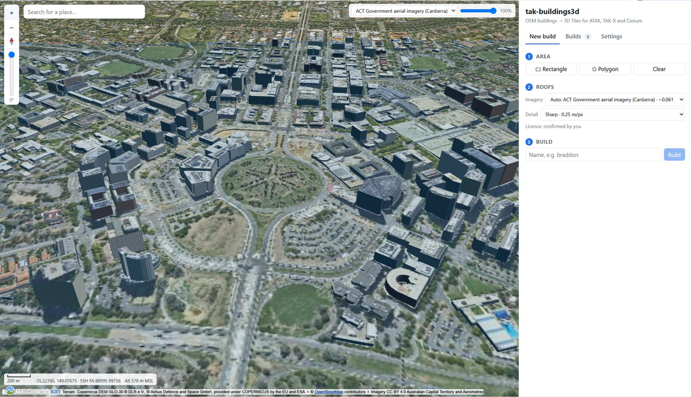
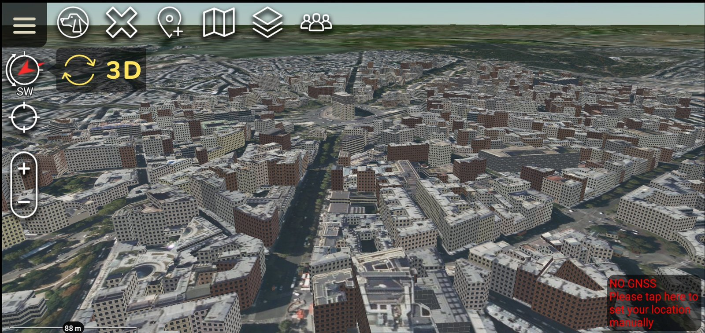

# tak-buildings3d

OpenStreetMap buildings as lightweight 3D Tiles for ATAK, TAK-X, CesiumJS and Cesium for Unreal,
with roofs textured from open aerial imagery.





<sub>Buildings © OpenStreetMap contributors (ODbL). Roof imagery: IGN BD ORTHO, Licence Ouverte / Etalab 2.0.</sub>

## Run

```bash
git clone https://github.com/TacticalSensorIntegration/tak-buildings3d.git
cd tak-buildings3d
docker compose up -d --build
```

Open <http://localhost:8000>, draw an area and click Build. To load a build into ATAK, copy its
zip to the device and use Import → Local SD.

Run it on your own computer or local network, not on the internet: it has no login.

## Next

Towers, masts, chimneys, wind turbines, silos and bridges.

## Licence

Code: [Apache License 2.0](LICENSE), © 2026 Tactical Sensor Integration.

Builds contain OpenStreetMap data (ODbL), Copernicus DEM heights and the imagery you chose, and
each zip includes the credits. Imagery you add yourself must be licensed for derived works. See
[LICENSES.md](LICENSES.md).
